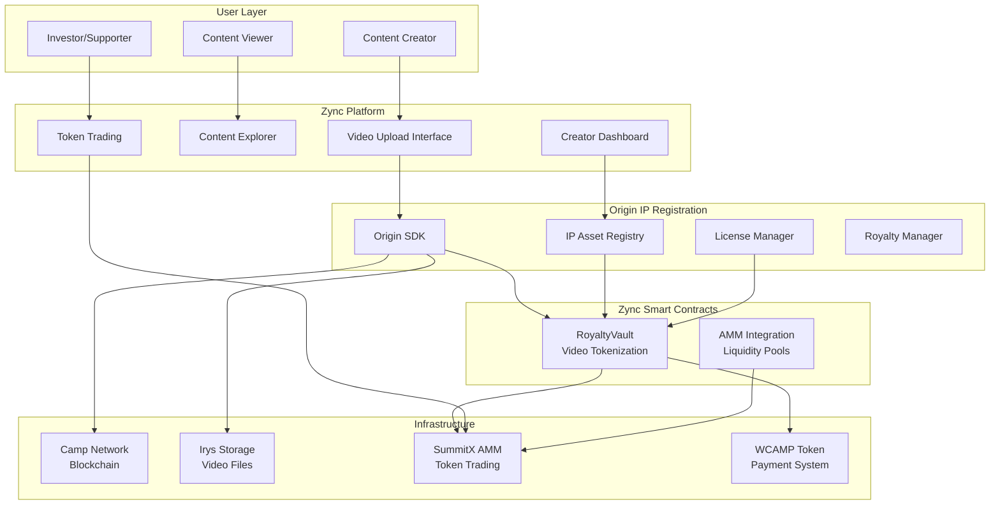
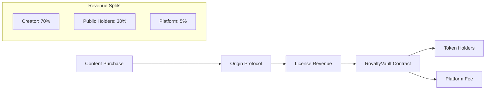

# Technical Architecture

## 🏗️ System Overview

Zync implements the **IP Ownership Markets** vision through a sophisticated architecture built on **Camp Network's blockchain infrastructure**. By leveraging Camp's specialized **Origin Protocol** (their IP tokenization framework) and **Proof of Provenance** consensus mechanism, Zync creates a bridge between traditional content creation and Web3 capital markets.

**Layered Architecture:**

**Layer 1: Camp Network Blockchain**
- Purpose-built Layer-1 for IP registration and AI-ready data
- Proof of Provenance consensus for cryptographic ownership verification
- Global state management for all IP transactions

**Layer 2: Origin Protocol (IP Infrastructure)**
- Comprehensive IP tokenization and management framework
- Global IP registry with tamper-proof provenance tracking
- Automated revenue distribution via graph-based relationships
- AI-ready rights-cleared data pools

**Layer 3: Zync Application Platform**
- Video-focused user interface and experience
- ERC20 tokenization for fractional video ownership
- AMM integration for immediate token liquidity
- Creator dashboard and analytics

**Layer 4: External Integrations**
- **SummitX AMM**: Decentralized exchange for token trading
- **Irys Storage**: Decentralized file storage via Arweave
- **WCAMP**: Native payment token for all transactions

This layered architecture enables creators to leverage enterprise-grade IP infrastructure while accessing capital markets through tokenization, democratizing previously exclusive PE-style revenue sharing deals.

## 📋 IP Ownership Markets Architecture



## 🛠️ Technology Stack

### **Frontend Stack**
- **Framework**: Next.js 15 with App Router
- **Language**: TypeScript
- **Styling**: Tailwind CSS 4
- **State Management**: React Query (TanStack Query)
- **UI Components**: Headless UI, Heroicons

### **Web3 Integration**
- **Wallet Connection**: RainbowKit 2.2+
- **Blockchain Interaction**: wagmi 2.15+ & viem 2.30+
- **Chain Support**: Camp Network (Testnet: 123420001114)
- **Token Standards**: ERC721 (NFTs), ERC20 (Video Tokens)

### **Smart Contract Stack**
- **Language**: Solidity 0.8.20
- **Framework**: Foundry + Hardhat
- **Standards**: OpenZeppelin Contracts 5.3+
- **Upgradeability**: Proxy patterns with OpenZeppelin Upgrades
- **Testing**: Forge + Hardhat test suites

### **External Integrations**
- **IP Management**: Origin Protocol SDK
- **Storage**: Irys (Arweave) for decentralized file storage
- **AMM**: SummitX (Uniswap V3 fork) for token trading
- **Payment Token**: WCAMP (Wrapped Camp Network token)

## 🏗️ Core Architecture Components

### **1. Origin Protocol Layer (Camp Network)**

Zync operates as an **application layer** built on top of Camp Network's Origin Protocol. All IP registration and management flows through Origin's infrastructure:

#### **Origin IP Registry** (Camp Network Core)
- **Purpose**: Global IP registration and provenance tracking
- **Functions**:
  - IP asset registration with tamper-proof records
  - ERC721 NFT minting for each registered IP
  - Automated parent-child relationship tracking
  - Revenue distribution graph management

#### **Origin SDK Integration**
```typescript
// Zync uses Origin SDK for all IP operations
import { OriginSDK } from '@campnetwork/origin';

const origin = new OriginSDK({
  network: 'camp-testnet',
  rpcUrl: 'https://rpc.basecamp.t.raas.gelato.cloud'
});

// IP registration happens through Origin
const ipAsset = await origin.registerIP({
  file: videoFile,
  metadata: { title, description },
  licenseTerms: { price, duration, royalty },
  usageRights: { aiTraining: true, derivativeWorks: true }
});
```

### **2. Zync Application Layer**

Zync adds video-specific tokenization and monetization on top of Origin's IP infrastructure:

#### **RoyaltyVault** (Zync's Smart Contract)
- **Purpose**: ERC20 tokenization for video IP assets registered in Origin
- **Token Economics**:
  - 1 billion tokens minted per video
  - 70% allocated to creator
  - 30% reserved for public sale
- **Revenue Integration**:
  - Receives revenue from Origin's licensing system
  - Distributes to token holders proportionally
  - Integrates with SummitX AMM for trading

```solidity
contract RoyaltyVault is ERC20 {
    address public originIpAsset;  // References Origin NFT
    
    function initialize(
        address _originIpAsset,
        string memory _name,
        string memory _symbol,
        address _creator
    ) external {
        originIpAsset = _originIpAsset;
        _mint(_creator, 700_000_000 * 10**18);  // 70% to creator
        _mint(address(this), 300_000_000 * 10**18);  // 30% for sale
    }
    
    // Receives revenue from Origin Protocol
    function receiveRoyalties() external payable {
        // Distribute to token holders
    }
}
```

### **2. Camp Network's Origin Protocol Integration**

**Important**: Zync does not have its own factory contract or IP management system. Instead, Zync is built as an **application layer** on top of Camp Network's Origin Protocol, which handles all IP registration, licensing, and core infrastructure. Zync focuses on the video-specific user experience and tokenization.

#### **IP Asset Management Framework**
Zync is built on **Camp Network's Origin Protocol** - a comprehensive IP tokenization and management framework specifically designed for the AI-driven creator economy. Unlike traditional NFT platforms, Origin provides:

**Core Origin Framework Features:**
- **IP Registry**: Global on-chain database of verifiable IP ownership with tamper-proof provenance
- **Graph Structure**: Hierarchical parent-child relationships that track derivative works and ensure attribution
- **Revenue Distribution**: Automated royalty splitting based on contribution graphs
- **AI-Ready Data**: Rights-cleared content pools that enable fair AI training with creator compensation
- **Legal Framework**: Smart contract-enforced licensing terms and usage rights

#### **Origin SDK Integration**
```typescript
// IP Asset Creation via Origin SDK
const { mintAsset } = useMintIpAsset();

await mintAsset(
  file,              // Video file (MP4/WebM)
  metadata,          // Title, description, creator info
  licenseTerms,      // Pricing, duration, royalty terms
  progressCallback   // Upload progress tracking
);

// Results in:
// 1. ERC721 NFT minted on Camp Network
// 2. IP registered in Origin's global registry
// 3. Provenance chain established
// 4. Revenue distribution graph created
// 5. AI training rights defined
```

#### **License Terms Structure**
```typescript
interface LicenseTerms {
  price: bigint;        // Access price in wei (WCAMP)
  duration: number;     // License duration in seconds
  royaltyBps: number;   // Creator royalty percentage (basis points)
  paymentToken: string; // WCAMP token contract address
  usageRights: {        // Origin Protocol extensions
    aiTraining: boolean;      // Allow AI model training
    derivativeWorks: boolean; // Enable remixing/clipping
    commercialUse: boolean;   // Commercial usage rights
  }
}
```

#### **Proof of Provenance**
Camp Network's **Proof of Provenance** consensus mechanism ensures every IP transaction is cryptographically linked to an immutable custody record:

```typescript
// Example provenance chain
interface ProvenanceRecord {
  originalCreator: string;     // Initial IP owner
  creationTimestamp: number;   // When IP was first registered
  parentIP?: string;           // If derivative work, link to parent
  usageHistory: UsageEvent[];  // All licensing and usage events
  revenueDistribution: {       // Automatic revenue splits
    creator: number;           // Percentage to original creator
    parents: number;           // Percentage to parent IP holders
    platform: number;          // Platform fee
  }
}
```

### **3. Token Architecture & Revenue Flow**

#### **Dual-Token System**
Zync implements a sophisticated dual-token architecture that bridges IP ownership with tradeable assets:

**1. Origin Protocol NFT (ERC721)**
- **Minted by**: Camp Network's Origin Protocol
- **Represents**: Legal IP ownership and licensing rights
- **Contains**: Provenance record, metadata, usage permissions
- **Holder**: Original creator (maintains IP ownership)

**2. RoyaltyVault Tokens (ERC20)**
- **Minted by**: Zync's RoyaltyVault contract
- **Represents**: Fractional revenue sharing rights
- **Supply**: 1 billion tokens per video
- **Distribution**: 70% creator, 30% public market

#### **Token Minting Process**
```typescript
// Step 1: Origin Protocol IP Registration
const originNFT = await originSDK.registerIP({
  file: videoFile,
  metadata: { title, description },
  licenseTerms: { price, duration, royalty }
});

// Step 2: Zync RoyaltyVault Deployment
const royaltyVault = await deployRoyaltyVault({
  originNFT: originNFT.tokenId,
  creator: creatorAddress,
  name: `${title} Revenue Tokens`,
  symbol: generateSymbol(title)
});

// Step 3: Token Distribution
// 700M tokens → Creator wallet
// 300M tokens → RoyaltyVault for public sale
```

#### **Revenue Distribution Flow**


#### **Token Economics Example**
For a video with **1 billion total tokens**:
- **Creator receives**: 700M tokens (70% of all future revenue)
- **Public sale**: 300M tokens available for purchase
- **Initial price**: 0.0001 CAMP per token
- **Market cap**: 100,000 CAMP (~$100,000 at launch)

When the video generates **$1,000 in licensing revenue**:
- **Token holders receive**: $950 distributed proportionally
- **Platform fee**: $50 (5%)
- **Per-token dividend**: $0.00000095 per token owned

#### **Token Utility & Rights**
**Revenue Rights**:
- Proportional share of all licensing revenue
- Claimable dividends from content monetization
- Future derivative work revenue (via Origin's graph)

**Governance Rights** (Future):
- Voting on content licensing terms
- Approval for derivative work permissions
- Community-driven content promotion

**Trading Rights**:
- Immediate liquidity on SummitX AMM
- Price discovery based on content performance
- Secondary market for revenue speculation

### **4. SummitX AMM Integration**

#### **Automatic Liquidity Creation**
When a video is registered, Zync automatically:

1. **Creates ERC20 Token**: Via RoyaltyVault clone
2. **Initializes Pool**: On SummitX with 1 CAMP
3. **Sets Initial Price**: 0.0001 CAMP per video token
4. **Enables Trading**: Immediate liquidity for investors

#### **DEX Configuration** (Camp Testnet)
```typescript
const SUMMIT_X_CONTRACTS = {
  WCAMP: '0x1aE9c40eCd2DD6ad5858E5430A556d7aff28A44b',
  Factory: '0xa2d92bE77cbA947D81860aB123e5dfC94DD0A10A',
  Router: '0xBCFF1D4737EA9E16C1D96F4B8949229Eb5ED1362',
  PositionManager: '0x509DeC0A801CBed9D2F5668A35fFBB469436761A'
};
```

## 🔄 IP Ownership Markets Data Flows

### **Creator Onboarding Flow (Current MVP)**
1. **Content Upload**: Creator uploads video (MP4/WebM, max 2GB) to Zync frontend
2. **Origin Protocol Registration** (via Origin SDK):
   - Video content registered in Camp Network's Origin IP Registry
   - ERC721 NFT minted by Origin with full provenance record
   - Content stored on Irys through Origin's infrastructure
   - Licensing terms, usage rights, and AI permissions defined
   - Revenue distribution graph established in Origin
3. **Zync Tokenization Layer**:
   - Zync deploys RoyaltyVault contract linked to Origin NFT
   - 1B ERC20 tokens minted (700M to creator, 300M for public)
   - RoyaltyVault configured to receive revenue from Origin's licensing
4. **Market Creation**: 
   - SummitX liquidity pool created at 0.0001 CAMP per token
   - Tokens immediately tradeable on decentralized exchange
5. **Revenue Integration**: All licensing revenue flows Origin → RoyaltyVault → Token holders

### **Investor Participation Flow** 
1. **Content Discovery**: Browse crypto-native videos on explore page
2. **Creator Analysis**: Review creator history, content quality, growth potential
3. **Token Purchase**: Buy video tokens at current market price
4. **Revenue Participation**: Earn proportional share of future video revenue
5. **Trading Strategy**: Hold for long-term revenue or trade on momentum

### **Revenue Sharing Flow (Future)**
1. **Content Monetization**: Video generates revenue through various streams
2. **Automatic Collection**: RoyaltyVault receives revenue payments
3. **Proportional Distribution**: Revenue split among token holders by ownership
4. **Claim Process**: Token holders claim accumulated dividends
5. **Reinvestment**: Participants can reinvest earnings into new content

### **Content Licensing Flow (Roadmap)**
1. **Rights Management**: Token holders gain licensing rights to content
2. **Clipping Permissions**: Create derivative content for other platforms  
3. **Revenue Attribution**: Original creator and token holders share derivative revenue
4. **Legal Framework**: Smart contracts enforce licensing terms automatically

## 🔌 API Architecture

### **Frontend APIs (Next.js App Router)**

Currently, Zync uses a **client-side architecture** with direct blockchain interaction. The main API endpoints are:

#### **Internal APIs**
- **Route Handlers**: `/src/app/api/` (Currently minimal - empty mint directory)
- **Server Components**: For SEO and performance optimization
- **Client Components**: For wallet interaction and real-time updates

#### **Planned API Endpoints**
```typescript
// Potential future API structure
GET    /api/videos           // List all videos
GET    /api/videos/:id       // Get video details
POST   /api/videos           // Upload new video
GET    /api/users/:address   // User profile and content
GET    /api/analytics        // Platform metrics
GET    /api/leaderboard      // Top performing content
```

### **Blockchain APIs (via wagmi/viem)**

#### **Contract Interaction Hooks**
```typescript
// Custom hooks for blockchain interaction
const { mintAsset } = useMintIpAsset();
const { buyAccess } = useBuyAccess();
const { hasAccess } = useHasAccess(assetId);
const { assets } = useAllIpAssets();
```

#### **Smart Contract Addresses**
Zync primarily interacts with Origin Protocol contracts and deploys its own RoyaltyVault contracts:

```typescript
// Origin Protocol contracts (Camp Network)
export const ORIGIN_CONTRACTS = {
  IPRegistry: '0x...', // Origin's IP Registry on Camp Network
  LicenseRegistry: '0x...', // Origin's License Management
  RevenueManager: '0x...', // Origin's Revenue Distribution
};

// Zync-specific contracts
export const ZYNC_CONTRACTS = {
  RoyaltyVaultFactory: '0x...', // Deploys RoyaltyVault instances
  RoyaltyVaultImpl: '0x...', // Implementation contract for clones
};

// External integrations
export const EXTERNAL_CONTRACTS = {
  WCAMP: '0x1aE9c40eCd2DD6ad5858E5430A556d7aff28A44b',
  SummitXRouter: '0xBCFF1D4737EA9E16C1D96F4B8949229Eb5ED1362',
  IrysNode: '0x...', // Decentralized storage
};
```

## 🔧 Development & Deployment

### **Local Development Setup**
```bash
# Clone repository
git clone https://github.com/your-org/zync.git
cd zync

# Install dependencies
npm install

# Start development server
npm run dev

# Smart contract development
npx hardhat compile
npx hardhat test
npx forge test
```

### **Environment Configuration**
```bash
# Frontend (.env.local)
NEXT_PUBLIC_CHAIN_ID=123420001114
NEXT_PUBLIC_RPC_URL=https://rpc.basecamp.t.raas.gelato.cloud
NEXT_PUBLIC_ORIGIN_API_KEY=your_origin_key

# Smart Contracts (.env)
CAMP_TESTNET_RPC_URL=https://rpc.basecamp.t.raas.gelato.cloud
PRIVATE_KEY=your_deployment_key
ETHERSCAN_API_KEY=your_explorer_key
```

### **Deployment Architecture**
- **Frontend**: Vercel deployment with automatic builds
- **Smart Contracts**: Foundry scripts for multi-network deployment
- **Storage**: Irys network for decentralized file hosting
- **Monitoring**: Contract events and analytics tracking

## 🔒 Security Architecture

### **Smart Contract Security**
- **OpenZeppelin Standards**: Battle-tested contract implementations
- **Proxy Patterns**: Upgradeable contracts with admin controls
- **Access Control**: Role-based permissions and ownership
- **Reentrancy Guards**: Protection against attack vectors

### **Frontend Security**
- **Wallet Integration**: Secure signature-based authentication
- **Input Validation**: Client and server-side validation
- **CORS Configuration**: Restricted cross-origin requests
- **Environment Variables**: Secure configuration management

## 📊 Monitoring & Analytics

### **Blockchain Monitoring**
- **Event Tracking**: All contract events indexed and monitored
- **Performance Metrics**: Gas usage and transaction success rates
- **User Analytics**: Wallet connections and platform usage

### **Application Monitoring**
- **Error Tracking**: Frontend error monitoring and alerting
- **Performance**: Core Web Vitals and user experience metrics
- **Uptime**: Service availability and response times

## 🚀 Scalability Considerations

### **Current Limitations**
- **Chain Dependency**: Currently limited to Camp Network
- **Storage Costs**: Large file uploads require WCAMP for Irys
- **Query Performance**: Direct blockchain queries for large datasets

### **Future Improvements**
- **Multi-Chain**: Expand to Ethereum, Polygon, and other networks
- **The Graph**: Implement subgraph for efficient data queries
- **Layer 2**: Consider rollup solutions for reduced gas costs
- **CDN Integration**: Hybrid storage with IPFS and traditional CDN

---

This technical architecture provides the foundation for a scalable, decentralized content platform that empowers creators while maintaining security and performance standards. 